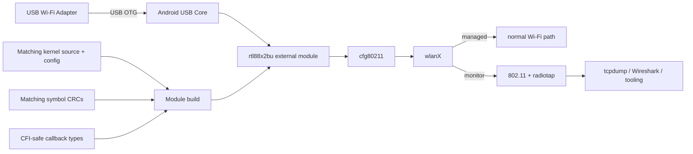
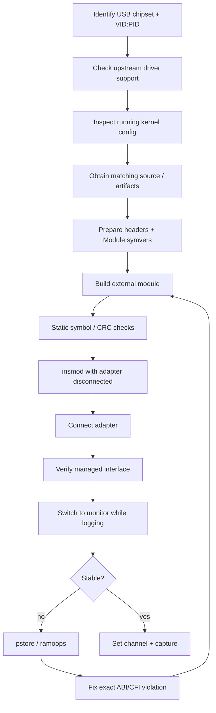

# 📡 Android RTL88x2BU Monitor Mode

<p align="center">
  <b>External USB Wi‑Fi → Android → CFI-safe kernel module → monitor mode → radiotap capture</b>
</p>

<p align="center">
  <code>USB NIC</code> → <code>rtl88x2bu</code> → <code>cfg80211</code> → <code>monitor</code> → <code>tcpdump</code>
</p>

> **Status:** monitor mode and real 802.11 packet capture verified on an Android GKI device using a TP-Link Archer T3U Plus / Realtek RTL88x2BU-class adapter — without replacing the phone kernel.

---

## The short version

This started as a simple question:

> *Can an external USB Wi‑Fi adapter with monitor-mode support on desktop Linux be made to work properly on rooted Android?*

The answer was **yes**, but the interesting part was not USB enumeration or even compiling the driver. The real fight was **runtime kernel compatibility**.

The module could compile. It could load. The USB device could bind. Android could expose a new wireless interface. `iw` could even report monitor-mode support.

And then the phone kernel panicked.

Twice.

Both crashes were caused by **Clang CFI catching function-pointer type mismatches in an older out-of-tree Realtek driver**. The final solution was to make the callback types exactly match the Android kernel ABI rather than trying to weaken CFI or replace the kernel.

```text
compile ✅
insmod ✅
USB bind ✅
managed interface ✅
monitor mode ✅
radiotap capture ✅
kernel replacement ❌ not required
```

---

## Hardware / software scope

This repository intentionally keeps host-specific and personal environment details out of the documentation.

Tested conceptually with:

- Android device with root access
- Android GKI-style kernel
- loadable kernel modules enabled
- Clang CFI / LTO enabled
- `cfg80211` available
- TP-Link Archer T3U Plus
- Realtek RTL88x2BU-family USB Wi‑Fi chipset
- upstream driver base: [`morrownr/88x2bu-20210702`](https://github.com/morrownr/88x2bu-20210702)

The adapter used here enumerates as:

```text
2357:0138
```

That ID is already recognized by the upstream driver family.

---

## Architecture



The subtle requirement is the bottom half: **a module that merely links is not necessarily ABI-safe enough to execute under CFI**.

---

## Why this was difficult

Three separate compatibility layers had to line up:

| Layer | Requirement | Failure mode |
|---|---|---|
| Kernel ABI | exported symbols + matching CRCs | `insmod` rejection / unresolved symbols |
| Compiler ABI | compatible Clang/LTO/CFI expectations | runtime CFI trap |
| Driver callbacks | exact kernel function-pointer types | kernel panic when code path executes |

The critical lesson:

> **`insmod` success does not prove runtime ABI correctness.**

A driver may sit happily in memory until a specific callback is exercised.

---

## Investigation timeline

### 1. Confirm the USB device exists

The first check was basic enumeration:

```bash
lsusb
```

Expected result includes the adapter VID:PID:

```text
2357:0138
```

At this stage the device can exist on USB while having **no network driver bound**.

Useful checks:

```bash
readlink -f /sys/bus/usb/devices/*/driver 2>/dev/null
ip link
```

---

### 2. Verify driver support before compiling

The chosen RTL88x2BU driver already contained the target USB ID and monitor-mode support.

Things worth checking in any out-of-tree Wi‑Fi driver before spending time on a build:

```bash
grep -R "2357.*0138" "$DRIVER_SRC"
grep -R "MONITOR" "$DRIVER_SRC"/Makefile "$DRIVER_SRC" 2>/dev/null | head
```

If the hardware ID is absent, add it only after confirming the actual chipset/revision.

---

### 3. Treat the running Android kernel as the source of truth

Do **not** build against a random kernel tree that merely shares the same major release.

For an external module, the important inputs are:

- matching kernel source
- running kernel configuration
- matching compiler assumptions
- matching exported symbol set
- matching `Module.symvers` CRC values when `CONFIG_MODVERSIONS=y`

Typical config extraction:

```bash
zcat /proc/config.gz > .config
```

Relevant options to inspect:

```bash
grep -E 'CONFIG_(MODULES|MODVERSIONS|CFI|LTO|TRIM_UNUSED_KSYMS|CFG80211)' .config
```

### Important: `modules_prepare` is not enough with MODVERSIONS

A common trap:

```bash
make modules_prepare
```

prepares headers and generated files, but it does **not** magically give you the running kernel's symbol CRC table.

If `CONFIG_MODVERSIONS=y`, the external module needs CRCs compatible with the running kernel. Prefer an official matching build artifact when available. Rebuilding the exact kernel tree is the fallback.

In this project, every imported symbol used by the final module was checked against the available kernel ABI before runtime testing.

---

### 4. Prepare a recovery path before touching kernel-adjacent code

Before experimenting with external modules, preserve the boot-critical images for the device.

Typical partitions worth identifying include:

```text
boot
vendor_boot
init_boot        # if present
vbmeta
dtbo
```

The exact partition layout is device-specific.

The important rule is simpler:

> **Have a tested path back before creating a path forward.**

For this project the custom-kernel route was kept as a fallback, but ultimately wasn't needed.

---

### 5. Build the external module against the prepared kernel output

A generic build shape looks like this:

```bash
export ARCH=arm64
export LLVM=1
export LLVM_IAS=1

make -C "$KERNEL_SRC" O="$KERNEL_OUT" olddefconfig
make -C "$KERNEL_SRC" O="$KERNEL_OUT" modules_prepare

cd "$DRIVER_SRC"
make clean
make -j"$(nproc)" \
  ARCH=arm64 \
  LLVM=1 \
  LLVM_IAS=1 \
  KSRC="$KERNEL_OUT" \
  KVER="$(make -s -C "$KERNEL_SRC" O="$KERNEL_OUT" kernelrelease)"
```

Your driver's Makefile may use different variable names. Read it instead of blindly copying build flags.

Before loading the module:

```bash
modinfo ./88x2bu.ko
llvm-nm -u ./88x2bu.ko
```

Check:

- architecture
- vermagic expectations
- imported symbols
- symbol CRCs
- signature policy
- module dependencies

---

## Crash #1 — old tasklet callback types vs CFI

The first module build could load and bind to the adapter. A new wireless interface appeared.

Switching into monitor mode exercised a receive/transmit tasklet path and triggered:

```text
__cfi_check_fail [88x2bu]
tasklet_action_common
```

That was the clue.

The legacy driver used callbacks shaped like:

```c
void usb_recv_tasklet(void *priv)
```

then forced them into the kernel API with a cast:

```c
(void (*)(unsigned long))usb_recv_tasklet
```

For a non-CFI build, that kind of cast may appear to "work" because the underlying register value is still pointer-sized.

Under Clang CFI, the indirect call target's **type identity** matters.

The kernel expected:

```c
void (*)(unsigned long)
```

So the correct fix was not a cast. The correct fix was changing the callback itself:

```c
static void callback(unsigned long data)
{
    void *priv = (void *)data;
    ...
}
```

and passing it directly to `tasklet_init()`.

The same cleanup was applied to RX, TX, and mesh tasklet handlers.

See:

- [`patches/0001-cfi-safe-tasklet-callbacks.patch`](patches/0001-cfi-safe-tasklet-callbacks.patch)

---

## Crash #2 — `ndo_start_xmit` looked compatible, CFI disagreed

After fixing the tasklets, the module got further — then crashed again.

The second persistent crash trace ended around:

```text
__cfi_check_fail [88x2bu]
xmit_one
sch_direct_xmit
```

The kernel declares `ndo_start_xmit` as:

```c
netdev_tx_t (*ndo_start_xmit)(struct sk_buff *, struct net_device *);
```

The Realtek driver used callbacks returning plain `int`.

Semantically, `netdev_tx_t` behaves like an integer result. But CFI does not care that the values are representation-compatible. It checks the function type.

So these callbacks were changed from:

```c
int callback(struct sk_buff *skb, struct net_device *dev)
```

to:

```c
netdev_tx_t callback(struct sk_buff *skb, struct net_device *dev)
```

including the main transmit path and monitor/management transmit callbacks.

See:

- [`patches/0002-cfi-safe-netdev-xmit-callbacks.patch`](patches/0002-cfi-safe-netdev-xmit-callbacks.patch)

---

## Android GKI-specific build friction

The driver also assumed a few helpers that are normal in many desktop kernels but may not be exported to external Android GKI modules.

Examples encountered during the port included:

- scheduler/yield helper differences
- kernel file I/O helpers unavailable to external modules
- a build-time unused-symbol whitelist path that only existed in the original CI environment

These are **build-environment issues**, not monitor-mode issues.

The approach used here was:

1. avoid relying on unavailable kernel-internal helpers when the feature was nonessential,
2. preserve the running configuration as closely as possible,
3. reconstruct or obtain the ABI symbol whitelist needed by symbol trimming,
4. verify the final module's imported symbols before loading it.

Do not cargo-cult those shims into another device. Check which symbols your running kernel actually exports.

---

## The final monitor-mode test

With the CFI callback fixes applied:

```bash
ip link set wlanX down
iw dev wlanX set type monitor
ip link set wlanX up
iw dev wlanX set channel 6
```

Verification:

```bash
iw dev wlanX info
```

Expected shape:

```text
type monitor
channel 6 (... MHz)
```

Then capture a small sample:

```bash
tcpdump -i wlanX -c 5 -s 128
```

The successful capture exposed:

- `IEEE802_11_RADIO`
- radiotap headers
- RSSI values
- channel metadata
- MCS/rate metadata
- control frames such as RTS/CTS
- normal 802.11 data frames

That proved the adapter was not merely "in monitor mode" according to `iw` — it was actually delivering raw wireless frames to userspace.

---

## Debugging with pstore / ramoops

The most useful forensic tool in this entire exercise was persistent kernel logging.

After an automatic reboot:

```bash
ls -l /sys/fs/pstore
cat /sys/fs/pstore/console-ramoops-* 2>/dev/null
```

Without `pstore`, both crashes would have looked like:

> "set monitor mode → phone rebooted"

With `pstore`, they became precise ABI bugs:

```text
Crash 1 → CFI failure in tasklet dispatch
Crash 2 → CFI failure in netdev transmit dispatch
```

That changed the problem from guessing to debugging.

---

## What **didn't** work

### "It compiles, so it should work"

False. Compilation validates the module against headers, not every runtime indirect-call edge.

### "It loads, so the ABI is fine"

Also false. `insmod` validates module loading constraints, symbol resolution, CRCs, etc. A callback can still have a CFI-incompatible function type that is only tested later.

### "Just disable CFI"

Possible in some custom-kernel scenarios, but it is the wrong first solution. CFI exposed real type-unsafety in the driver. Fixing the driver preserved kernel hardening and avoided a kernel replacement.

### "Use any source tree with the same kernel family"

Dangerous with Android kernels. Vendor hooks, symbol trimming, MODVERSIONS, ABI whitelists, and toolchain details can all matter.

---

## A safer workflow for future ports



---

## Repository layout

```text
.
├── README.md
├── SECURITY.md
├── .gitignore
├── docs/
│   ├── BUILD-AND-DEBUG.md
│   └── SANITIZATION.md
└── patches/
    ├── 0001-cfi-safe-tasklet-callbacks.patch
    └── 0002-cfi-safe-netdev-xmit-callbacks.patch
```

No compiled kernel module, boot image, device backup, crash dump, host path, SSID, IP address, MAC address, account token, or device-specific secret is intentionally included.

---

## Key takeaways

1. **Android GKI can load useful third-party Wi‑Fi modules** if the ABI requirements are respected.
2. **MODVERSIONS and CFI solve different problems.** Correct symbol CRCs do not guarantee correct indirect-call types.
3. **Old driver casts are suspicious under CFI.** If a function pointer is being forced into a callback type, inspect it.
4. **Monitor mode activates unusual code paths.** Managed-mode stability is not enough validation.
5. **`pstore` turns kernel panics into actionable evidence.**
6. **Fix the module before weakening the kernel.** In this case, no custom kernel was required.

---

## Responsible use

Monitor mode is a diagnostic and research capability. Capture or inject wireless traffic only on networks and devices you own or have explicit authorization to test.

This repository documents driver/kernel compatibility work. It is not a guide for unauthorized access.

---

## Credits

- Linux wireless / cfg80211 ecosystem
- Android GKI tooling and kernel hardening
- Realtek driver community
- [`morrownr/88x2bu-20210702`](https://github.com/morrownr/88x2bu-20210702)

---

<p align="center"><code>CFI complained. We listened.</code></p>
