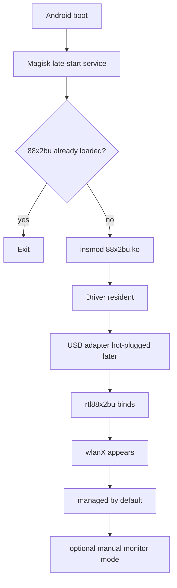

# Boot-persistent driver autoload with Magisk

Once the external RTL88x2BU module is proven stable, the cleanest persistence layer is a tiny Magisk module that runs `insmod` after Android has completed boot.

This does **not** make monitor mode automatic. It only makes the driver available after every reboot.

## Desired lifecycle



## Why late-start instead of forcing it earlier

A Wi-Fi USB driver does not need to be injected at the earliest possible boot stage. Loading it after Android has completed boot is simpler and reduces the chance of colliding with early userspace initialization.

The generic service logic is:

```sh
#!/system/bin/sh
MODDIR=${0%/*}
LOG="$MODDIR/driver.log"

resetprop -w sys.boot_completed 0

if grep -q '^88x2bu ' /proc/modules 2>/dev/null; then
    echo "already loaded" >> "$LOG"
    exit 0
fi

insmod "$MODDIR/88x2bu.ko" >> "$LOG" 2>&1
```

The module first waits for Android boot completion, checks whether the driver is already loaded, and only then calls `insmod`.

## Magisk module layout

```text
rtl88x2bu-monitor/
├── module.prop
├── customize.sh
├── service.sh
└── 88x2bu.ko
```

The `.ko` is intentionally omitted from this repository. A kernel module built for one kernel must not be treated as a portable binary for another device.

## Example `module.prop`

```properties
id=rtl88x2bu_monitor
name=RTL88x2BU Android Monitor Mode Driver
version=1.0
versionCode=1
author=your-name
description=Autoloads a compatible RTL88x2BU kernel module after Android boot. Monitor mode remains manual.
```

## Example `customize.sh`

```sh
ui_print "RTL88x2BU Android driver autoload"

if [ "$ARCH" != "arm64" ]; then
  abort "Unsupported architecture: $ARCH"
fi

set_perm "$MODPATH/service.sh" 0 0 0755
set_perm "$MODPATH/88x2bu.ko" 0 0 0644
```

## Verification after reboot

Check that Android completed boot normally:

```sh
getprop sys.boot_completed
```

Confirm the driver was autoloaded:

```sh
lsmod | grep 88x2bu
```

Then connect the USB adapter and verify that a new interface appears:

```sh
lsusb
ip -br link
```

The adapter should remain in managed mode until explicitly changed.

## Switching to monitor mode manually

Replace `wlanX` with the external adapter interface:

```sh
ip link set wlanX down
iw dev wlanX set type monitor
ip link set wlanX up
iw dev wlanX set channel 6
```

Verify:

```sh
iw dev wlanX info
```

Capture:

```sh
tcpdump -i wlanX -c 5 -s 128
```

If the interface is already in monitor mode, some `tcpdump` builds may reject `-I`; use the interface directly instead.

## Returning to managed mode

```sh
ip link set wlanX down
iw dev wlanX set type managed
ip link set wlanX up
```

## Recovery considerations

Kernel modules execute in kernel space. A bad module can panic the device even if `insmod` succeeds initially.

Before enabling autoload:

- validate the module manually first,
- keep a known-good boot path,
- keep Magisk recovery/safe-mode options available,
- do not package a module built for one kernel as a universal download.

If a boot-protection module is used, treat it as an extra safety layer, not as a substitute for backups and recoverability.

## What was verified in this project

The final persistent flow was validated end-to-end:

```text
clean reboot
→ Android boot completed
→ Magisk autoloaded 88x2bu
→ adapter connected after boot
→ USB device detected
→ wlanX appeared automatically
→ interface switched to monitor mode
→ radiotap / raw 802.11 frames captured
→ device remained stable
```

That is the practical difference between "the driver can be loaded" and **the phone now behaves as if the external adapter is a supported hot-pluggable peripheral**.
